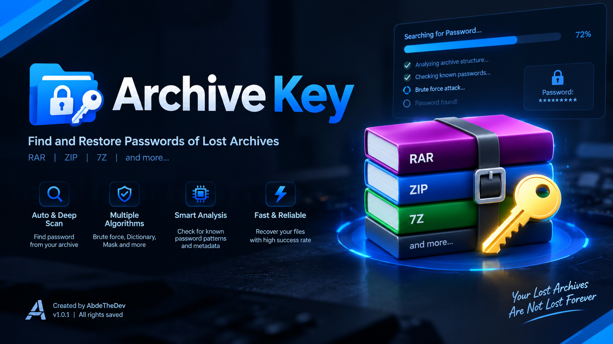
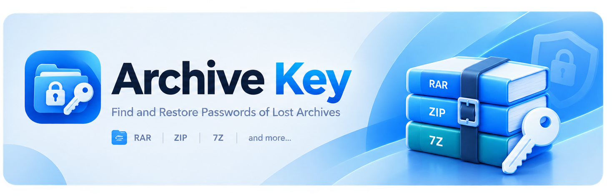
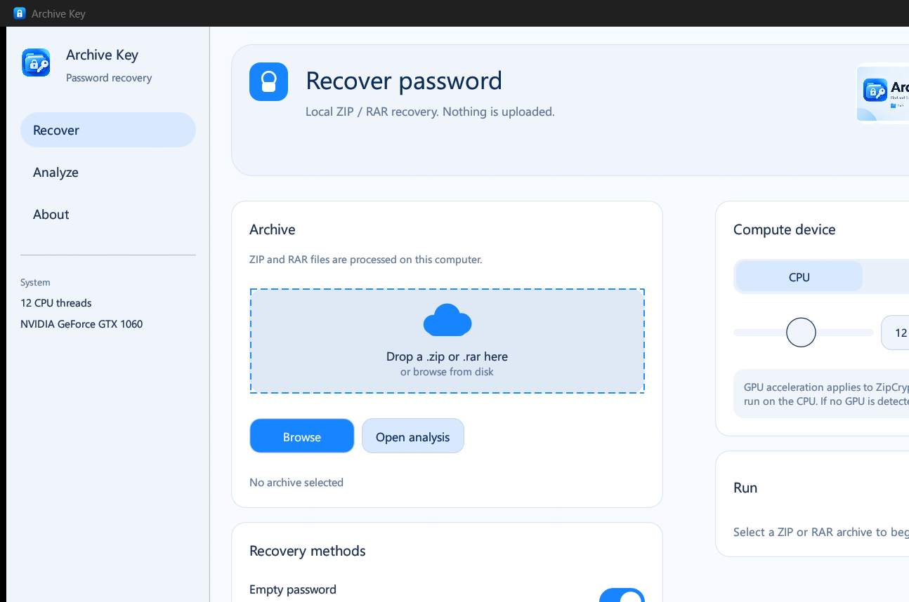

<p align="center">
  
</p>

<h1 align="center">Archive Key</h1>

<p align="center">
  <b>Recover lost ZIP and RAR passwords on this computer.</b><br>
  One executable. No installer. Nothing is uploaded.
</p>

<p align="center">
  <a href="https://github.com/AbdeTheDev"></a>
  
  
  
</p>

<p align="center">
  
</p>

---

## Screens

<p align="center">
  
</p>

<p align="center">
  
</p>

<p align="center"><i>Recover dashboard — drop a ZIP or RAR, pick methods, then start recovery.</i></p>

---

## What it does

Archive Key is a local Windows desktop app for archives **you are authorized to access**.

- Identifies ZIP / RAR encryption and tries a quick recovery during analysis
- Empty password, common passwords, custom word lists, hybrid mutations, and generated search
- Algorithms: Smart, Incremental, Mask, Dictionary, Hybrid, Combinator, PIN, Toggle case, Word + year
- CPU, GPU (ZipCrypto), or both
- Recovered password can be copied from the window

Files stay on this PC. There is no account and no cloud.

---

## Supported formats

| Format | What Archive Key does |
| --- | --- |
| **ZIP · ZipCrypto** | Recovers on CPU; GPU acceleration when a compatible adapter is found |
| **ZIP · WinZip AES** | Recovers on CPU (key derivation is not GPU-accelerated) |
| **RAR 5** | Recovers when a password-check value is present |
| **RAR 4** | Detected in analysis; file encryption is not recovered in this edition |

Only `.zip` and `.rar` are accepted. Other extensions are not advertised as working.

---

## How to use

1. Run `ArchiveKey.exe`.
2. Drop a `.zip` or `.rar` on the dashed area, or choose **Browse**.
3. Wait for analysis (the app tries empty and common passwords automatically).
4. Adjust methods, algorithm, character set, and CPU/GPU if needed.
5. Click **Start recovery**.
6. Copy the password when it is found.

### Mask tokens

Used when the algorithm is **Mask**:

| Token | Meaning |
| --- | --- |
| `?l` | lowercase `a–z` |
| `?u` | uppercase `A–Z` |
| `?d` | digit `0–9` |
| `?s` | symbols |
| `?a` | the character set selected in the window |
| other | treated as a literal character |

Example: `?l?l?l?d?d` → three lowercase letters, then two digits.

### Word list

UTF-8 text, one candidate per line. Lines starting with `#` are ignored.

---

## Download / build

### Run the release binary

Use the built executable:

```text
ArchiveKey2.0.exe
```


---

## GPU notes

- GPU acceleration applies to **ZipCrypto**.
- WinZip AES and RAR 5 key derivation run on the **CPU**.
- If no compatible GPU is detected, recovery continues on the CPU.

---


---

## Responsible use

Use Archive Key only on archives you own or are authorized to open. Recovering passwords for other people’s files without permission may be illegal.

---

## License

MIT. Created by [AbdeTheDev](https://github.com/AbdeTheDev).

---

<p align="center">
  Created by <a href="https://github.com/AbdeTheDev">AbdeTheDev</a><br>
  <a href="https://github.com/AbdeTheDev">github.com/AbdeTheDev</a>
</p>
